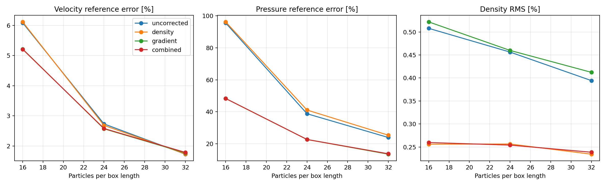
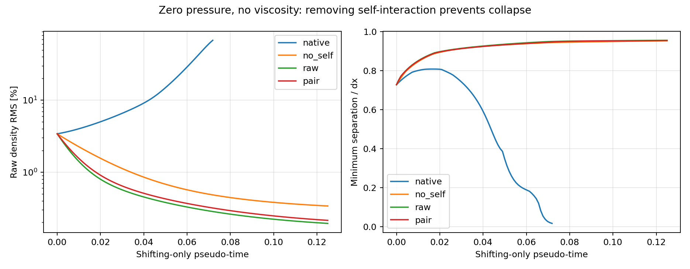
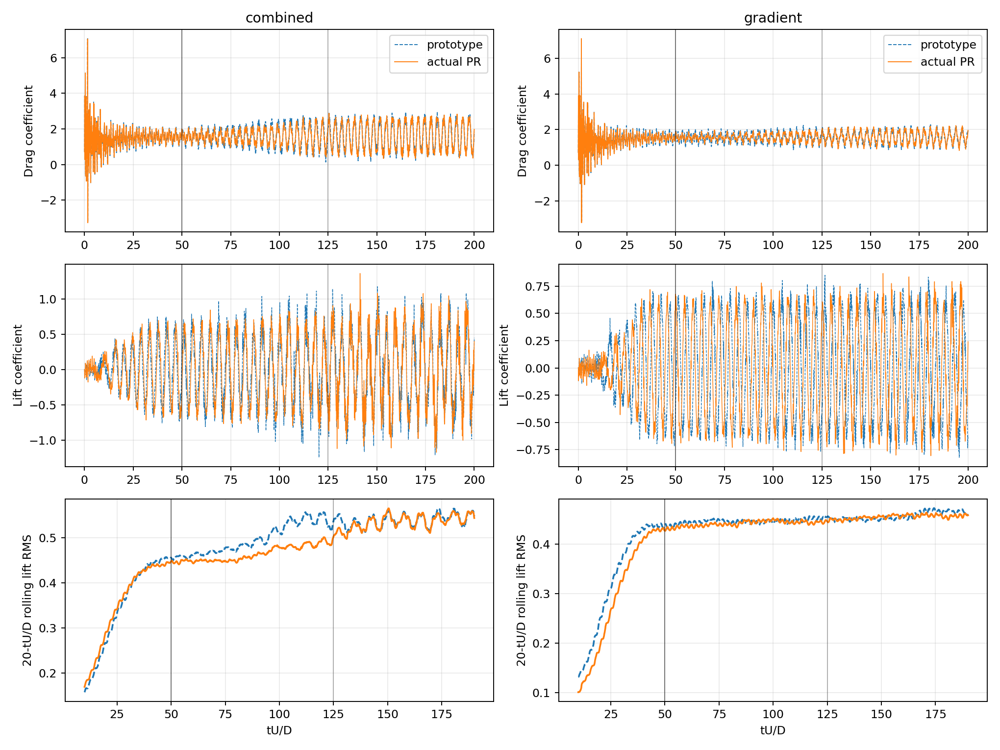
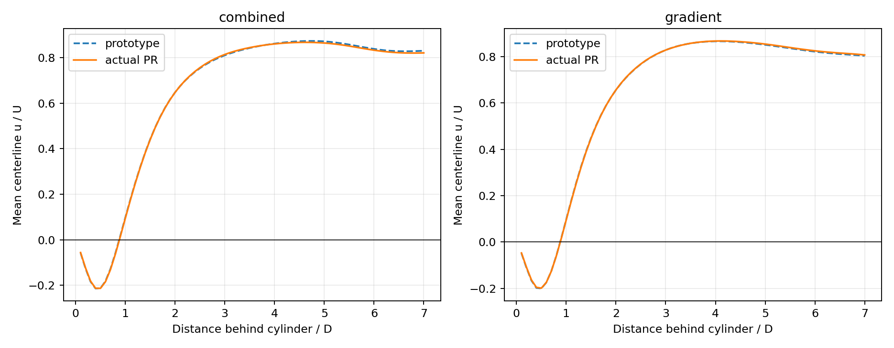

# Correction impact: results and conclusions

Recorded study snapshot: **17 October 2026**. All requested simulation batches
have finished; no further simulation is launched by the report tools.

**Four implementation defects were identified and fixed. Density and mixed-gradient
corrections improve particular metrics, but a general accuracy advantage for the
corrected cylinder configurations has not yet been established.** The remaining
limitations are pressure-force accuracy on disordered particles, combined-case
statistical settling, and force convergence of the independent reference.

## 1. Code base and validation

This report branch is based on the integration of:

- [PR #1293](https://github.com/trixi-framework/TrixiParticles.jl/pull/1293),
  correction-stack head `39c77fd3674a19ba4afb543dbc135276c9fb9fca`.
- [PR #1359](https://github.com/trixi-framework/TrixiParticles.jl/pull/1359),
  operator-fix head `7fc2c5837a44fbb589a91b0af96f05beb821e85f`.

The combined integration is `300997906`. The actual-repeat source files for viscosity,
PST, and mirroring match the PR; pressure references retain the correction-stack API
and the PR's connected-component reference and reciprocal offsets. Source hashes
are retained in [provenance.json](evidence/provenance.json).

The standalone fixes passed **23,198 CPU unit checks** and Aqua. Their integration
with the correction stack passed **865 targeted checks**. The uncorrected repeat
pilot reproduced all saved velocity, density, pressure, and vorticity field values
bitwise. Eight short actual-library native-PST/pressure checks completed.

At the recorded snapshot, upstream PR #1359's platform tests, documentation,
spelling, and coverage checks passed, while its formatting job failed. This is a
recorded status, not a promise about later GitHub checks; resolving it is a TODO.
Local CUDA execution was unavailable because of the driver/runtime mismatch.

## 2. Confirmed implementation defects

| Defect | Fix and evidence |
| --- | --- |
| EDAC pressure reduction | Symmetrized neighbor-local offsets can cancel affine pressure acceleration. A spatially constant reference shared by connected active fluids preserves the bulk gradient and pressure-gauge behavior. Tests cover split/disconnected fluids, buffers, and reciprocal mixed-fluid evaluation. |
| Corrected viscosity | Asymmetric endpoint gradients caused linear-momentum drift. A reciprocal fluid-pair gradient reduced the tested drift from about `1e-3` to roundoff. The library retains the established boundary/structure gradient handling. |
| Native shifting | A nonzero corrected self-gradient entered the PST sum and produced self-shifting. Skipping zero-distance interactions eliminates the reproduced collapse without zeroing physical gradients. |
| Ghost reconstruction | A boundary slot incorrectly selected a fluid-particle correction cache. Query-local raw-kernel moments removed the dependency; the isolated affine error decreased from `0.866` to approximately `9e-16`. |

All four are implemented in PR #1359. The earlier open-boundary activation and
buffer-reuse cache preparation is in [PR #1353](https://github.com/trixi-framework/TrixiParticles.jl/pull/1353).

### Reproducibility finding

Early apparently large before/after differences were contaminated by parallel
neighbor ordering and adaptive-step amplification. Deterministic rebuilding made
the matched raw-geometric-regularizer comparisons byte-identical. That does not
invalidate the separately reproduced native cache/shift defects: it isolates the
comparison from changes in regularization and floating-point ordering.

## 3. Operator consistency and bulk accuracy

Ninety correction configurations were screened, with 210 region-wise records.
Gradient correction reproduces affine fields in a difference-gradient operator;
mixed correction also removes the constant-field residual in the direct operator.
This distinction does not automatically carry over to a conservative pressure force.

For example, one perturbed-cloud affine-pressure snapshot has exact acceleration
`(-3, 2)`. The mixed-gradient global-reference result restores a close mean but
still has pointwise acceleration RMS error about **1.60**. Constant-reference and
momentum fixes therefore do not close the pressure-force consistency problem.

### Controlled Taylor–Green refinement

Means over three paired layouts at 32 particles per box length:

| Correction | Velocity relative L2 error | Pressure relative L2 error | Density RMS |
| --- | ---: | ---: | ---: |
| Uncorrected | 1.73% | 23.90% | 0.394% |
| Shepard density | 1.74% | 25.35% | 0.234% |
| Mixed gradient | 1.77% | 13.47% | 0.412% |
| Combined | 1.79% | 13.73% | 0.239% |

These historical controlled runs use geometric regularization, the research
pair-viscosity prototype, and pressure reduction disabled. They are not labeled
as exact-PR trajectories. The reference is incompressible Taylor–Green; errors
include EDAC compressibility and pressure diffusion as well as discretization.

**Mixed correction improves pressure accuracy here; Shepard reduces density noise.
There is no clear velocity-accuracy gain at the finest tested resolution.**

## 4. Native-shifting root cause

The 48-run pressure/viscosity matrix showed collapse in all 12 native mixed-gradient
and combined cases, including disabled/global pressure references and pair-symmetric
viscosity. It also occurs with uniform velocity, zero pressure, and no viscosity.

Normalized kernels can have a nonzero physical self-gradient. In PST it becomes a
spurious self-shift, magnified by the near-origin kernel weight. For one small
longitudinal density perturbation the measured rate decomposes as:

| Contribution | Rate |
| --- | ---: |
| Other particles | -54.72 |
| Self-interaction | +74.54 |
| Total | **+19.82: amplification** |

Excluding only zero-distance interactions restores damping in this mode. Timestep
halving/quartering, weaker strength, fixed volume weights, and a displacement cap
alone do not establish a cure. The full spectrum also contains transverse
square-lattice modes amplified by uncorrected/raw operators; this is not a proof
of stability for every mode or layout.

The minimal exclusion completed **24/24 validation cases** across 16/24/32 particles
per box length, two layouts, mixed/combined corrections, and global/disabled pressure
reduction. Default strength and original volume weights were retained, with no cap.
The library regression produced **12 failures before** the fix and passed **16/16
afterward**, while preserving a nonzero physical self-gradient.

## 5. Open-boundary findings

The retained tests cover uniform through-flow, short-time Poiseuille drift,
pressure-pulse and exiting-vortex disturbances, and rotated/scaled/reindexed ghost
reconstruction. Quiet and long-domain controls separate startup/bulk effects from
outlet-induced disturbances. The transport measures are disturbance indicators,
not pure continuum reflection coefficients. No boundary model is established as
universally best.

First-order reconstruction reduced outlet/pressure errors in the short channel
test. Stage-wise reconstruction changed those errors very little and was not
adopted as a library default. The 1,080-record matched ghost matrices did not
justify a determinant-threshold change.

### Long matched boundary-order comparison

Uncorrected n=16 cylinder, pressure reduction off, geometric regularization,
statistics over `tU/D=50–200`:

| Metric | Zeroth-order | First-order | Relative change |
| --- | ---: | ---: | ---: |
| Mean drag | 1.544313 | 1.545829 | +0.098% |
| Lift RMS | 0.428032 | 0.428510 | +0.112% |
| Strouhal | 0.226337 | 0.226182 | -0.069% |

Both runs pass stationarity and contain 33 shedding cycles. The cycle-block drag
difference interval includes zero. Mean-wake velocity RMS difference is **0.53% U**;
mean density RMS changes from **0.6855% to 0.6705%**. Recorded transfer mass budgets close.

The coarse last-negative-probe recirculation metric jumps from `0.9D` to `0.8D`.
Interpolating the same zero crossing gives **0.9033D versus 0.8976D**; the apparent
11% change is a binning artifact, not a resolved recirculation improvement.

**Bulk force differences are small in this coarse uncorrected control.** This does
not establish the accuracy of every corrected boundary configuration.

## 6. Actual-library cylinder repeats

Both actual-PR repeats reached `tU/D=200`, with 176,000 accepted steps, no rejected
steps, and zero recorded transfer mass-budget residual. They use n=16, Re=200,
pressure reduction off, and geometric regularization. Native PST/pressure-enabled
paths were exercised by the short library checks, not these long trajectories.

The earlier prototype applied pair-symmetric viscosity to corrected boundary
interactions too; the PR changes reciprocal fluid-fluid pairs and retains boundary
handling. These repeats test that material implementation difference.

| Case | Mean drag | Change vs prototype | Lift RMS | Change | Strouhal | Change |
| --- | ---: | ---: | ---: | ---: | ---: | ---: |
| Mixed gradient | 1.566230 | -0.014% | 0.449791 | -0.429% | 0.225035 | -0.234% |
| Combined | 1.590832 | -0.491% | 0.500669 | -3.590% | 0.221147 | +0.760% |

Mean-wake velocity RMS differences are **0.29% U** and **0.43% U**. Density RMS
decreases from `0.849%` to `0.816%` and `1.481%` to `1.305%`, respectively.

### Statistical limitation

The predeclared gate requires at least 20 cycles, half-window changes below 2% for
drag and lift RMS, and below 1% for Strouhal. Both repeats fail in `50–200`:

| Case | Drag drift | Lift-RMS drift | Strouhal drift |
| --- | ---: | ---: | ---: |
| Mixed gradient | 0.79% | **3.32%** | 0.75% |
| Combined | **2.81%** | **14.69%** | **2.17%** |

Mixed-gradient passes a **post-hoc** `100–200` check with 21 cycles. This diagnostic
does not replace the original acceptance window. Combined correction still has
7.59% lift-RMS drift and 1.08% frequency drift in `100–200`.

The actual PR is close to the prototype in mean flow, but unresolved settling is
comparable to or larger than the changes being compared. An accuracy improvement
is not statistically established.

## 7. Independent reference: not yet accepted

WaterLily 1.9.1 provides an independent incompressible Cartesian/BDIM reference
(Weymouth & Font, 2025, doi:10.1016/j.cpc.2025.109748). Its periodic Taylor–Green
velocity error decreases from **0.981% to 0.0684% to 0.0167%** at 16/32/64 cells.
Embedded stationary planes impose the matching no-slip channel walls. Its convective
outlet differs from the SPH treatment, so outlet-distance acceptance is required.

The reference cylinder forces fail spatial convergence:

- 64 → 96 cells per diameter: **10.9% drag**, **6.0% lift-RMS** change.
- Strouhal changes by only **0.069%**.
- The outlet-distance test passes: **0.025% drag**, **0.22% lift-RMS** change.

The focused audit found analytic stress-integration errors below **0.3%**. Tighter
pressure solves change transient drag by **0.32–0.46%**, while natural versus forced
exact-time stepping changes it by **8.68%**. The time-stepping/sampling schedule is
the largest observed sensitivity. These short transients do not close the
full-horizon discrepancy; the reference remains unsuitable for force-accuracy claims.

## 8. Runtime and stopping decisions

The broad control sweep was stopped instead of spending roughly six more days on
it. Two original-setting controls failed with nonfinite diagnostics; their failure
history and the interrupted control trace remain in the raw archive.

The focused reference/boundary pass completed in about **6.6 hours**, within its
12-hour cap. Actual-library repeats took **7.92 hours** and **13.32 hours**, totaling
**21.24 hours**, within the 30% planning margin and the separate 24-hour cap. The
combined runtime exceeded its individual pilot estimate; identical step counts
alone do not establish why. Long-run extensions should first gain validated restart
checkpoints rather than repeat the entire startup.

## 9. What is and is not established

- The four operator/cache defects and their targeted fixes are supported by isolated regressions.
- Pressure accuracy and density noise improve in particular controlled cases.
- Stable finite integration does not by itself establish statistical or physical convergence.
- The present cylinder data do not establish a universally better correction or boundary model.
- [TODO.md](TODO.md) defines the next work and its success criteria.
